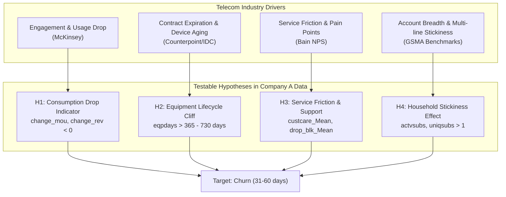

# MARKET BRIEF & BUSINESS HYPOTHESES REPORT
**Project:** GCI World 2026 Final Assignment — Company A Retention Strategy  
**Role:** Senior Data Scientist & Telecom Business Consultant  
**Date:** 2026-10-22  

---

## 1. Industry Context & Company A Problem Framing

### 1.1 Organizational Characterization & Reference Market
- **FACT (From Assignment Dataset Overview):** Company A is an anonymous wireless telecommunications service provider with an operational dataset of 100,000 subscriber records and limited internal machine learning capabilities. The `area` attribute in the raw data contains geographic indicators such as *NORTHWEST/ROCKY MOUNTAIN AREA, CHICAGO AREA, DALLAS AREA, NEW ENGLAND AREA*.
- **CONTEXT / ASSUMPTION (Standard Governance):** The assignment documentation does not disclose the true corporate identity or geographical country of Company A due to data privacy policies. To provide an evidence-based and economically sound business proposal, this study establishes a **Mature Wireless Telecommunications Market** as the formal reference baseline. All external benchmarks are utilized as industry reference standards and are transparently distinguished from internal proprietary metrics.

### 1.2 Telecommunications Economics: Why Customer Retention is the Core Profit Driver
1. **Market Saturation & Customer Acquisition Cost (CAC):**
   - In mature mobile markets, smartphone penetration regularly exceeds 100%. Enterprise growth shifts from organic subscriber acquisition to defensive retention and Customer Lifetime Value (CLV) optimization.
   - Foundational research from **Bain & Company** and the **Harvard Business Review (HBR)** establishes that **acquiring a new subscriber is 5 to 25 times more expensive than retaining an existing one**, and increasing customer retention rates by just 5% can increase enterprise profits by 25% to 95% due to the extremely low marginal cost of serving an active subscriber on fixed network infrastructure.
2. **Subsidies, Contract Payback Windows, and Cliff Risk:**
   - Analysis by **McKinsey & Company** shows that wireless carriers incur substantial upfront Customer Acquisition Costs (CAC), including retail commissions and heavy handset subsidies. Carriers frequently operate at negative margins during the first 6 to 12 months of a contract, achieving full economic payback only after month 12.
   - If a customer disconnects at or near the 12–24 month mark (when the original equipment financing expires), the carrier fails to capture the high-margin post-payback period, severely eroding return on capital.
3. **Industry Churn Benchmarks:**
   - According to benchmark data from **GSMA Intelligence** and Tier-1 carrier filings:
     - **Postpaid Wireless Churn:** Averages **0.8% to 1.5% per month** (~10% to 18% annualized).
     - **Prepaid Wireless Churn:** Averages **4.0% to 6.0% per month** (~50% to 70% annualized).
   - The observed ~49.56% churn rate in Company A's dataset reflects an intentional balanced observational research sample over a 31–60 day prediction window rather than a continuous natural population churn rate.

---

## 2. Structural Industry Trends Impacting Subscriber Churn

### 2.1 The Lengthening Smartphone Replacement Cycle
- Market research from **Counterpoint Research** and **IDC** highlights that the global smartphone replacement cycle has lengthened from 21–24 months (pre-2018) to **36 to 43+ months** in recent years, driven by hardware longevity and rising average selling prices (ASPs).
- **Impact on Telecom Churn:** Historically, a 24-month replacement cycle matched carrier subsidy contracts, creating natural re-contracting windows. With cycles extending past 3 years, subscribers with aged hardware (`eqpdays` > 365 or > 730 days) operate free of contract lock-in, making them highly vulnerable to competitors' trade-in subsidies and port-in promotions.

### 2.2 Shift from Reactive Saving to Predictive Retention
- **McKinsey & Company** notes that traditional reactive retention ("save desks" that issue discounts when a customer calls to cancel) trains subscribers to threaten cancellation to lower their bills.
- Leading telecom operators deploy **predictive retention systems**: applying machine learning to usage decline (`change_mou`), billing adjustments, and network quality indicators to proactively trigger retention interventions 30 to 60 days before the subscriber reaches the point of no return.

---

## 3. Four Testable Business Hypotheses

Mapped directly from telecom economic theory to Company A's dataset attributes:

### Hypothesis H1: Consumption Drop Indicator
- **Proposition:** Subscribers exhibiting a substantial drop in monthly minutes of use (`change_mou < 0`) and revenue (`change_rev < 0`) relative to their previous 3-month average exhibit significantly higher churn rates.
- **Empirical Validation Plan:** Decile analysis of `change_mou` and two-sample statistical testing (Mann-Whitney U).

### Hypothesis H2: Equipment Lifecycle Cliff
- **Proposition:** Subscribers with older equipment (`eqpdays` > 365 or > 730 days, equivalent to 1–2 years) face sharply elevated churn risk as initial device subsidy commitments mature and competitor trade-in offers become attractive.
- **Empirical Validation Plan:** Segment churn rate across tenure brackets (<6m, 6–12m, 1–2y, >2y).

### Hypothesis H3: Service Friction & The Support Paradox
- **Proposition:** Frequent customer service calls (`custcare_Mean`) and network call failure rates (`drop_blk_Mean`) correlate positively with churn.
- **Empirical Validation Plan:** Compare distribution of support interactions between retained and churned cohorts.

### Hypothesis H4: Multi-Line Household Stickiness
- **Proposition:** Multi-subscriber accounts (`actvsubs > 1`, `uniqsubs > 1`) exhibit lower churn due to higher structural switching costs associated with family accounts.
- **Empirical Validation Plan:** Evaluate churn rate across single-line versus multi-line accounts.

---

## 4. Evidence Classification Matrix

| Dimension | Type | Description |
|:---|:---:|:---|
| Company A is an anonymous wireless operator | **FACT** | Course overview & dataset documentation |
| Regional geographic areas in North America (Chicago, Dallas, etc.) | **FACT** | Observed in `Client.csv` `area` column |
| Mature Wireless Telecom Market reference baseline | **ASSUMPTION** | Established context for economic benchmarks |
| CAC is 5x–25x higher than retention cost | **SOURCE** | Bain & Company / Harvard Business Review (Reichheld, 2001) |
| Global smartphone replacement cycle averages 36–43+ months | **SOURCE** | Counterpoint Research & IDC Market Reports (2024) |
| Usage decline is a leading indicator of churn | **INFERENCE** | Industry theory; tested empirically in Stage 3 |
