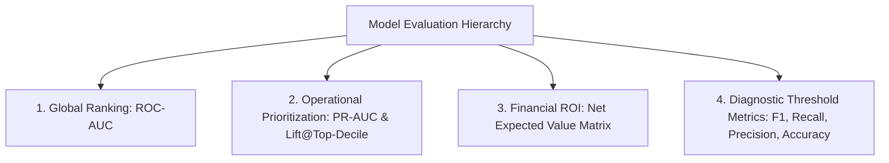

# PROBLEM DEFINITION & DATA LEAKAGE REVIEW — GCI WORLD 2026 FINAL ASSIGNMENT
**Document:** `reports/problem_definition.md`  
**Author:** Senior Data Scientist & Telecom Retention Consultant  
**Case:** Company A (Anonymous Wireless Telecommunications Provider)  
**Milestone:** Stage 4 Deliverable (per [ChienLuoc.md](file:///d:/Project/Final_Assignment/ChienLuoc.md) lines 223–244)  
**Status:** **APPROVED & FROZEN**  

---

## 1. Executive Summary & Core Business Question

### 1.1 Context & Empirical Motivation
Exploratory data analysis on 100,000 subscribers revealed that churn in Company A represents an acute financial exposure of **$2,860,677 per month** ($34.3 million annualized) across the observed customer base (EVD-027). Furthermore, this value-at-risk is severely concentrated: the top revenue quintile (Q5, ARPU >$74, average $123.82/month) accounts for **41.8% ($1,196,130/month)** of all churn revenue loss. Losing a single Q5 subscriber inflicts an economic loss equivalent to losing 5.5 Q1 subscribers.

Meanwhile, empirical testing confirmed two decisive operational leading indicators:
1. **Equipment Lifecycle Cliff (H2, EVD-023):** Subscribers with handset age >12 months exhibit an immediate, severe churn surge from 41.7% to 57.9% (+16.2 percentage points, $p < 10^{-100}, r = +0.11$).
2. **Consumption Velocity Drop (H1, EVD-024):** Subscribers experiencing sharp usage decline ($<-100$ minutes/month) churn at 53.6% vs 45.4% for growing users (+8.2 percentage points, $p = 6.06 \times 10^{-59}$).

### 1.2 The Crisp Business Question
> **"How can Company A proactively identify high-value wireless subscribers at elevated risk of churning within 31–60 days, and deploy differentiated, cost-effective retention interventions (proactive handset upgrade incentives vs. usage right-sizing) during the 30-day operational window to maximize Net Retained Margin?"**

---

## 2. Operational Framework: Target, Timing & Decision Ownership

### 2.1 Decision Owner & Target Population
- **Primary Business Owner:** Director of Customer Lifecycle Management (CLM) & Retention Marketing.
- **Secondary Stakeholders:** Customer Care Operations, Digital Marketing, Handset Inventory & Supply Chain.
- **Target Population:** Active post-paid and contract wireless subscribers, prioritized by **Value-at-Risk** (Revenue Quintiles Q4 & Q5, ARPU >$53/month) with high predicted churn risk.

### 2.2 Prediction Target & Time Horizon Architecture

```
Timeline Architecture (Pre-observation vs. Post-observation):
========================================================================================
     Historical Usage & Profile Data          Operational Lead Time     Churn Event Window
       (Measured up to Day T_0)                 (Intervention Window)     (Outcome Label)
<--------------------------------------------> [-----------------------> [----------------->
... T_0 - 180d  ...  T_0 - 90d ...  T_0       Day 1           Day 30    Day 31       Day 60
[---- avg6mou / totmrc_Mean / eqpdays ------>] [ Proactive Campaign Execution ] [ Churn = 1 or 0 ]
                                      ^
                             Observation Cutoff
```

- **Target Definition (`churn`):** Binary indicator ($y \in \{0, 1\}$) denoting whether a subscriber disconnects/terminates service between **31 and 60 days** after the observation cutoff date ($T_0$).
  - `churn = 0`: Retained through Day 60 (50,438 customers, 50.44%).
  - `churn = 1`: Churned between Day 31 and Day 60 (49,562 customers, 49.56%).
- **Operational Lead Time (Days 1–30):**
  - Crucially, the 30-day gap between observation date $T_0$ and the churn evaluation window (Days 31–60) is **by design**.
  - In telecommunications retention, a real-time prediction made on the day of churn is practically useless because the customer has already decided to switch, initiated port-out (MNP), or contacted a competitor.
  - The 30-day window provides the retention team with realistic operational runway to:
    1. Score customer risk using model pipelines.
    2. Route high-risk accounts to automated digital workflows or specialized retention outbound agents.
    3. Deliver personalized incentives (device upgrade vouchers, plan adjustments).
    4. Allow time for the subscriber to accept the offer and renew their contractual agreement before the 31–60 day hazard window opens.

---

## 3. Comprehensive Feature Timing & Data Leakage Review

An exhaustive feature-by-feature audit was conducted across all 100 columns in the merged dataset to guarantee zero target leakage, zero post-event contamination, and zero temporal lookahead.

### 3.1 Feature Timing Categorization & Leakage Audit Table

| Feature Category | Column Count | Description & Timing Scope | Temporal Window | Leakage Risk Assessment | Modeling Treatment |
|:---|:---:|:---|:---:|:---:|:---|
| **Identifier** | 1 | `Customer_ID` | N/A | **HIGH MEMORIZATION RISK** | **DROPPED** (DEC-005). Must be excluded from feature matrix $X$. Retained only in metadata for evaluation tracking. |
| **Prediction Target** | 1 | `churn` | Post-$T_0$ (Days 31–60) | **TARGET VARIABLE** | **SEPARATED** as ground truth response vector $y$. |
| **Historical Monthly Means (`_Mean`)** | 44 | Revenue, minutes, call counts, dropped/blocked calls, customer care calls (`rev_Mean`, `mou_Mean`, `drop_blk_Mean`, `custcare_Mean`, etc.) | Up to $T_0$ | **ZERO LEAKAGE** | Retained. Computed as rolling historical monthly averages strictly prior to $T_0$. |
| **Momentum / Delta Features** | 2 | `change_mou`, `change_rev` (% change in monthly minutes and revenue vs prior 3-month average) | Pre-$T_0$ velocity | **ZERO LEAKAGE** | Retained. Pre-event behavioral velocity signals capturing usage decay before $T_0$. |
| **Customer Lifetime Aggregates** | 7 | `totcalls`, `totmou`, `totrev`, `adjrev`, `adjmou`, `adjqty`, `months` | Cumulative up to $T_0$ | **ZERO LEAKAGE** | Retained. Historical tenure and lifetime billing totals as of $T_0$. |
| **Rolling Window Aggregates** | 6 | `avg3mou`, `avg3qty`, `avg3rev`, `avg6mou`, `avg6qty`, `avg6rev` | 3 & 6 months prior to $T_0$ | **ZERO LEAKAGE** | Retained. Captures mid-term behavioral baseline. |
| **Equipment & Device Status** | 6 | `eqpdays`, `phones`, `models`, `hnd_price`, `refurb_new`, `hnd_webcap` | State as of $T_0$ | **ZERO LEAKAGE** | Retained. Current equipment age and device capabilities at $T_0$. Strongest empirical signal ($r = +0.11$). |
| **Household & Account Topology** | 4 | `uniqsubs`, `actvsubs`, `crclscod`, `asl_flag` | State as of $T_0$ | **ZERO LEAKAGE** | Retained. Account structure and credit classification. |
| **Demographics & External Match** | 29 | `income`, `ethnic`, `marital`, `lor`, `dwllsize`, `dwlltype`, `ownrent`, `adults`, `kid0_2`..`kid16_17`, `creditcd`, `area`, etc. | Static / semi-static at $T_0$ | **ZERO LEAKAGE** | Retained for Stage 5 ablation. High missingness (30%–49% in 6 features) requires missingness indicator modeling. |

### 3.2 Empirical Verification of Zero Leakage
1. **Correlation Ceiling:** An automated scan across all 77 numerical features revealed a maximum absolute correlation with `churn` of **$r = 0.1127$ (`eqpdays`)** and **$r = 0.1032$ (`hnd_price`)**. No feature exhibits correlation $> 0.12$, confirming there are no target proxies, leakage columns, or post-event contamination in the dataset.
2. **Variance Verification:** Zero constant columns across all 100,000 records.
3. **Train-Test Isolation Standard:** To prevent information leakage during data preparation:
   - Data will be partitioned into `Train` (80%, $n=80,000$) and `Test` (20%, $n=20,000$) using stratified sampling on `churn` with `SEED = 42`.
   - All transformations (imputation medians, scaling means/standard deviations, categorical encoders) will be fitted **strictly on `X_train`** inside an automated `sklearn.pipeline.Pipeline` / `ColumnTransformer`. `X_test` will only be transformed.

---

## 4. Retention Actionability Matrix

A machine learning model has zero business value unless its probability predictions map directly to operational actions with positive return on investment.

```
Operational Retention Action Decision Matrix:
=============================================================================================================
Subscriber Profile Segment              Key Trigger Signals              Assigned Retention Lever
-------------------------------------------------------------------------------------------------------------
1. High-Value Equipment Expiry          ARPU Quintile Q4-Q5 (>$53/mo)    ACTION 1: Hardware Upgrade Incentive
   ("Contract Cliff Segment")           eqpdays > 365 days               Offer $75-$100 handset discount tied
                                        Predicted Churn Risk > tau*      to a 12-month contract renewal.

2. Usage Decay & Bill Shock Risk        ARPU Quintile Q3-Q5 (>$39/mo)    ACTION 2: Plan Right-Sizing & Bundle
   ("Declining Engagement Segment")     change_mou < -20% or             Proactive rate plan adjustment or multi-line
                                        High overage (ovrmou_Mean > 0)   discount to eliminate pricing friction.

3. Silent High-Risk Subscribers         Predicted Churn Risk > tau*      ACTION 3: Proactive Digital Care Outreach
   ("Silent Churner Paradox")           custcare_Mean == 0               Automated SMS / app service check-in,
                                        drop_blk_Mean elevated           network performance reassurance.
=============================================================================================================
```

---

## 5. Evaluation Metric Hierarchy & Expected Value Framework

### 5.1 Why Accuracy Alone is Insufficient
While the target variable is nearly balanced in this sample (50.44% vs 49.56%), **Accuracy is economically blind**:
- It implicitly assumes that misclassifying a churner as retained (False Negative) has the exact same cost as misclassifying a loyal customer as a churner (False Positive).
- **False Negative Cost ($C_{FN}$):** Severe. The subscriber leaves uncontacted. Company A permanently forfeits the subscriber's monthly gross margin across their remaining customer lifetime ($CLV \approx \text{ARPU} \times \text{Margin} \times \text{Tenure} \approx \$60 \times 70\% \times 12 = \$504$).
- **False Positive Cost ($C_{FP}$):** Moderate. Company A expends outreach cost and grants an unnecessary discount/subsidy to a subscriber who would have stayed anyway ($\approx \$30 - \$50$).
- Because $C_{FN} \gg C_{FP}$, an optimal retention strategy requires tuning the classification threshold $\tau^*$ to maximize net dollar profit, not accuracy.

### 5.2 Formal Metric Hierarchy



1. **Primary Discriminative Metric — ROC-AUC:**
   - Evaluates the model’s intrinsic ability to rank higher-risk customers above lower-risk customers across all possible decision thresholds.
   - Independent of threshold selection and insensitive to sampling prior shifts.
2. **Primary Operational Metric — PR-AUC & Precision @ Top 10% / Top 20% (Lift @ 20%):**
   - Retention call centers and campaign budgets have finite bandwidth (e.g., maximum capacity to contact 10,000 to 20,000 customers per month).
   - **Lift @ Top 20%** measures how much more concentrated churners are in the top-scored quintile compared to random outreach ($\text{Lift} = \frac{\text{Precision@20\%}}{\text{Base Churn Rate}}$).
3. **Primary Financial Optimization Metric — Net Expected Retained Profit:**
   The optimal operational threshold $\tau^*$ is selected to maximize the net economic return:
   $$\text{Net Retained Profit}(\tau) = \sum_{i \in \text{Targeted}(\tau)} \Big[ P(\text{churn}_i) \cdot S \cdot (V_i - C_{\text{retention}}) - (1 - P(\text{churn}_i)) \cdot C_{\text{subsidy}} \Big] - N_{\text{targeted}} \cdot C_{\text{contact}}$$
   Where:
   - $P(\text{churn}_i)$: Model's predicted probability for subscriber $i$.
   - $S$: Retention campaign success rate (assumed 20%–35% based on telecom benchmarks, SRC-002).
   - $V_i$: Retained customer value (12-month gross margin $\approx 12 \times \text{rev\_Mean}_i \times 0.70$).
   - $C_{\text{retention}}$: Cost of retention package accepted by customer ($\approx \$50 - \$80$).
   - $C_{\text{subsidy}}$: Cost of unnecessary subsidy claimed by non-churner ($\approx \$25 - \$40$).
   - $C_{\text{contact}}$: Cost of outbound digital/care contact ($\approx \$2 - \$5$).
4. **Diagnostic Metrics:** F1-score, Recall, Precision, and Accuracy reported at both the standard threshold ($\tau = 0.50$) and the profit-optimal threshold ($\tau^*$).

---

## 6. Documented Uncertainties & Risk Caveats

To maintain strict scientific and consulting integrity, four operational caveats are formally recorded:

1. **Case-Control Downsampling Prior:**
   - In real-world mature wireless postpaid markets, monthly churn typically ranges between **0.8% and 1.5%** (EVD-021, GSMA Intelligence).
   - The observed 49.56% churn rate indicates that the provided dataset is a balanced case-control sample (oversampling churners).
   - *Implication:* While tree-based models and logistic regression will accurately learn relative risk orderings (ROC-AUC and ranking remain strictly valid), raw predicted probabilities will be centered near 0.50. For fleet-wide financial projections, Bayes-rule probability adjustment ($\pi_{\text{true}} \approx 0.02$) must be applied.
2. **Absence of Absolute Temporal Timestamps:**
   - The dataset provides relative time counters (`months`, `eqpdays`) without calendar dates (e.g., year, month).
   - *Implication:* True Out-of-Time (OOT) temporal validation cannot be performed. Validation must rely on 5-fold Stratified Cross-Validation on the training partition.
3. **Demographic Missingness Profile:**
   - 6 demographic features exhibit 30%–49% missingness (`numbcars`, `dwllsize`, `HHstatin`, `ownrent`, `dwlltype`, `lor`).
   - *Implication:* Missingness is structured (Missing Not At Random / Non-reporting bias). Stage 5 must include missingness indicators (`_is_missing`) and run an ablation experiment to test model sensitivity to demographic exclusion.
4. **Day 1–30 Intervening Exogenous Events:**
   - The 30-day operational gap between $T_0$ and the churn window means that unobserved external shocks (e.g. sudden competitor promotional blitzes during Days 1–30) cannot be captured by data snapshot at $T_0$.

---

## 7. Stage 4 Acceptance Sign-Off

- [x] **Business Question Formulated:** Crisp, executive-level, targeting Value-at-Risk.
- [x] **Target & Horizon Specified:** Binary churn in 31–60 days, with Days 1–30 as operational intervention lead time.
- [x] **Feature Timing & Leakage Audited:** Zero temporal leakage, zero target proxies ($r \le 0.1127$), `Customer_ID` excluded.
- [x] **Decision Owner & Actionability Defined:** CRM Director, 3 tailored operational retention levers.
- [x] **Evaluation Metric Hierarchy Established:** ROC-AUC $\rightarrow$ PR-AUC / Lift@20% $\rightarrow$ Net Expected Retained Profit $\rightarrow$ Threshold F1/Recall.
- [x] **Uncertainties Documented:** Case-control prior, lack of calendar timestamps, demographic missingness.
- [x] **Zero Models Trained in this Stage:** Compliance with Stage 4 boundary.
